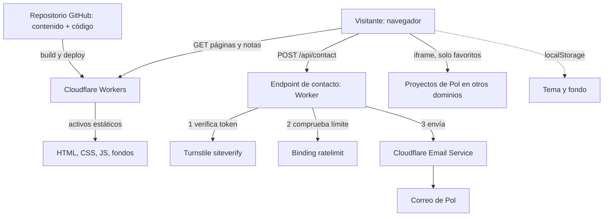

# Arquitectura técnica

> **Mike OS (Vercel):** adaptador `@astrojs/vercel`, Node.js 24 y cabeceras de producción en `vercel.json`. Las rutas `/api/contact`, `/api/guestbook` y `/api/guestbook/confirm` usan `src/server/services.ts`: configuración de entorno de Astro, Resend y contadores Redis atómicos con caducidad de 60 segundos. Sin configuración completa no se habilita el envío. `content/`, `.env*`, `.dev.vars*` y cachés locales se excluyen del repositorio y del despliegue. `wrangler.jsonc`, `.dev.vars.example` y las secciones históricas de Cloudflare se conservan como referencia de la plantilla; no intervienen en el despliegue actual.

> **Mike OS:** el estado de esta adaptación y las fuentes del contenido están en [contenido-mike.md](contenido-mike.md). El Stack combina un catálogo profesional manual con estadísticas opcionales de GitHub; actualmente no hay recuentos publicados. La carpeta `content/` es referencia local y se excluye de la comprobación de tipos.

La copia de GitHub incluye todos los repositorios públicos del perfil, sin filtrar por topics. El PDF del CV se sirve con `Cache-Control: no-store` y un enlace versionado con la huella del texto que lo generó; la web y el PDF utilizan el mismo Markdown. Los iconos propios se mantienen como SVG y se exportan a PNG con el Sharp incluido en Astro.

> **Plantilla:** este documento es el de Pol OS, el portfolio de Pol Marzà del que nace esta plantilla. Déjalo como ejemplo del método o reescríbelo para tu proyecto.

<!-- Documento vivo. Actualizar cada vez que cambie el stack, la estructura de carpetas
     o cualquier decisión técnica relevante.
     Los cambios deben registrarse también en changelog/. -->

---

## Stack seleccionado

| Capa | Tecnología | Justificación |
|------|-----------|---------------|
| Framework | **Astro** (con `@astrojs/cloudflare`) | Las páginas se generan en la compilación, con casi nada de JavaScript por defecto. Solo el escritorio es una isla interactiva. Cada nota tiene su URL con HTML completo (SEO). |
| Interfaz del escritorio | **Svelte 5** (isla de Astro) | Gestor de ventanas, dock y apps con mucho estado en el cliente y poco peso. Ver "Decisiones técnicas". |
| Contenido | **Content collections de Astro** (Markdown y JSON/YAML en el repo) | El contenido se edita con commits. Sin base de datos, sin panel de administración. Tipado y validado al compilar. |
| Base de datos | **Ninguna** | No hay datos que persistan en el servidor. Las preferencias del visitante (tema, fondo) van en `localStorage`. |
| Autenticación | **Ninguna** | No hay cuentas ni área privada. La pantalla de acceso es decorativa. |
| Estilos | **CSS propio con variables** | El diseño ya está definido con tokens en `docs/design-system.md`. No hace falta un framework de utilidades. |
| Correo del formulario | **Cloudflare Email Service** (binding `send_email`) | Envía desde el propio Worker, sin cuenta de otro proveedor. Beta pública. |
| Anti-bots | **Cloudflare Turnstile** + binding `ratelimit` | Verificación en servidor y límite de envíos por IP. |
| Despliegue | **Cloudflare Workers** (activos estáticos + un Worker) | Recomendado por Cloudflare para proyectos nuevos frente a Pages. Sin base de datos que se duerma. |
| Gestor de paquetes | **pnpm v11** | Convención del proyecto. |
| Pruebas | Vitest (lógica) y Playwright (flujos en local) | Ver `docs/testing.md`. |

---

## Diagrama de componentes



---

## Estructura de carpetas

```
src/
├── content/              → Contenido editable (colecciones de Astro)
│   ├── projects/         → Un archivo por proyecto: nombre, dominio, resumen y detalle, capturas, repositorio, enlace, si es incrustable
│   ├── notes/            → Una nota por archivo Markdown (título, fecha, descripción, cuerpo)
│   ├── favorites/        → Un archivo JSON por sección de Favoritos (juegos, películas, libros, música): el top 10 de Pol con sus portadas
│   ├── guestbook/        → Una reseña aprobada del Libro de visitas por archivo JSON (nunca lleva correo)
│   ├── stack.json        → El Stack: herramientas con su recuento y año (lo genera scripts/actualizar-stack.mjs cada día)
│   ├── sobre-mi.md       → Texto de Sobre mí (+ la huella del PDF generado)
│   ├── como-esta-hecho.md → El documento «Cómo está hecho» (ventana y página pública)
│   └── links.ts          → Accesos directos externos (newsletter, GitHub, LinkedIn)
├── content.config.ts     → Esquemas y loaders de las colecciones (Astro 6+ lo exige aquí)
├── pages/
│   ├── index.astro       → Home: pantalla de acceso y escritorio
│   ├── sitemap.xml.ts    → Mapa del sitio, generado al compilar (src/lib/seo.ts)
│   ├── notas/[slug].astro→ Nota con su HTML completo; el escritorio la abre en una ventana
│   ├── 404.astro         → Página no encontrada dentro del mismo entorno
│   ├── libro-de-visitas/confirmar.astro → Botón «Confirmar» del enlace del correo (no se indexa)
│   ├── favoritos.json.ts → Las cuatro secciones de Favoritos para la ventana (estático)
│   ├── libro-de-visitas.json.ts → Reseñas aprobadas para la ventana (estático)
│   ├── como-esta-hecho.astro y .json.ts → La página pública de «Cómo está hecho» y los datos de su ventana (estáticos)
│   └── api/              → contact.ts (formulario de correo) y guestbook.ts + guestbook/confirm.ts (Libro de visitas): el único código de servidor
├── os/                   → Isla del sistema operativo (Svelte)
│   ├── menus.ts          → Menús de la barra de menú (función pura: qué hay y qué está desactivado)
│   ├── shell/            → Pantalla de acceso, barra de menú, dock, escritorio, modo móvil
│   ├── windows/          → Gestor de ventanas: mover, redimensionar, foco, ampliar
│   ├── apps/             → Navegador, Proyectos, Correo, Mi CV (about), Notas, Stack, Terminal, Memory, Damas, Ajustes
│   ├── terminal/         → Comandos de la Terminal como funciones puras (`commands.ts`) y los minijuegos (`games/`, bajo demanda)
│   └── stores/           → Estado compartido (preferencias, navegador, `os-actions`: puente app → sistema)
├── lib/                  → Utilidades (validación del formulario, preferencias, fechas)
├── styles/               → Variables de diseño (tokens) y estilos globales
└── assets/               → Foto de Pol, iconos, CV en PDF
public/
├── _headers              → Cabeceras de seguridad (frame-ancestors, nosniff…)
├── robots.txt            → Qué se indexa (excluye /api/) y dónde está el mapa
├── favoritos/            → Las portadas de Favoritos (.jpg), una carpeta por sección y un archivo por elemento
├── projects/             → Iconos propios de los proyectos y, en una carpeta por proyecto, sus capturas (WebP y GIF)
├── links/                → Iconos de los accesos directos externos (LinkedIn, GitHub, Con Criterio)
├── site.webmanifest      → Nombre e iconos para la pantalla de inicio del móvil
├── favicon.svg|.ico, apple-touch-icon.png, icon-192|512.png → Iconos (generados, ver scripts/)
└── og.jpg                → Imagen para compartir el enlace (1200 × 630, generada)
scripts/
├── verificar-cobertura.mjs → Comprueba las tablas de cobertura de las fichas contra el PRD
├── generar-imagenes.mjs    → Genera los iconos y og.jpg en public/ (necesita Chrome; no forma parte del despliegue)
├── generar-cv.mjs          → Genera public/cv.pdf a partir de src/content/sobre-mi.md (necesita Chrome)
├── actualizar-stack.mjs    → Analiza los repositorios de GitHub y escribe src/content/stack.json (lo lanza la tarea diaria)
├── actualizar-proyectos.mjs → Copia de GitHub (API pública, sin claves) los lenguajes, etiquetas y licencia de cada proyecto con `repo`
└── plantillas/og.html      → Plantilla de la imagen para compartir
tests/
├── unit/                 → Vitest (junto al código: *.test.ts)
├── e2e/                  → Playwright contra `pnpm dev`, siempre en localhost
└── csp/                  → Playwright contra la compilación: cabeceras, CSP, SEO y rendimiento
wrangler.jsonc            → Configuración del Worker, bindings y variables públicas
```

---

## Estrategia de autenticación

**No hay autenticación.** Es una decisión de producto (ver `docs/prd.md`, WON'T): el contenido se
edita en el repositorio, así que no hace falta que nadie inicie sesión.

La pantalla de acceso es decorativa: muestra un campo de contraseña relleno que no acepta texto, y
un clic o Enter da paso al escritorio. No hay cookie de sesión ni estado en servidor.

Consecuencia de seguridad: no hay nada que robar ni que forzar. La única superficie de ataque es
`POST /api/contact`, que se protege con validación en servidor, Turnstile y límite de frecuencia.

---

## Integraciones externas

- **Cloudflare Turnstile:** el formulario de Correo muestra el widget y envía su token. El endpoint
  lo valida contra `https://challenges.cloudflare.com/turnstile/v0/siteverify` con la clave secreta
  antes de hacer nada más. En local se usan las claves de prueba publicadas por Cloudflare.
- **Cloudflare Email Service:** el endpoint envía el mensaje con `env.EMAIL.send()`. Requiere que
  el dominio del remitente use Cloudflare DNS y esté dado de alta en Email Sending. El destino (el
  correo de Pol) debe estar verificado en la cuenta.
- **Binding `ratelimit` de Workers:** limita los envíos por IP antes de llamar a Turnstile. El Libro de visitas añade otros dos: por IP (5 por minuto) y por clave (1 por minuto: el correo de destino o el enlace de confirmación).
- **Servicios de música (S-03):** pendiente. Se incrustaría una lista de YouTube o Spotify; no se
  aloja audio propio.
- **Proyectos de Pol en el Navegador (M-10):** cada uno se carga en un iframe desde su propio
  dominio. Ver "Navegador interno y cabeceras".

### Contrato del endpoint de contacto

`POST /api/contact`, cuerpo JSON `{ from, subject, message, turnstileToken }`.

1. Rechaza con 405 cualquier método distinto de POST y con 415 si el cuerpo no es JSON.
2. Aplica el límite por IP. Si se supera: 429, sin más trabajo.
3. Valida longitudes y formato en servidor (correo válido, asunto de hasta 150 caracteres, mensaje de
   hasta 5.000). Si falla: 422 con el campo que falla.
4. Verifica el token de Turnstile. Si falla: 403.
5. Envía el correo con `to` fijo desde la configuración (nunca desde el cuerpo de la petición),
   `from` de un dominio propio, `replyTo` con el correo del visitante y el mensaje solo como texto
   plano, sin HTML. Si el envío falla: 502 con un mensaje claro, sin detalles internos.
6. No guarda el mensaje ni lo escribe en los registros del Worker.

### Contrato de los endpoints del Libro de visitas

Dos pasos, sin guardar nada en el servidor (decisión del 2026-10-11).

`POST /api/guestbook`, cuerpo JSON `{ kind, name, detail, relation, text, email, links, consent, turnstileToken, website }`, con
`kind` = `new`, `edit` o `remove`.

1. 405 si no es POST, 415 si no es JSON, 413 si pasa de 16 KB.
2. Límite por IP (5 por minuto): 429.
3. Campo trampa `website` relleno: 200 sin hacer nada más.
4. Valida en servidor (`src/lib/guestbook.ts`, la misma que el formulario): 422 con los campos que fallan.
5. Verifica Turnstile: 403.
6. Falta `from`, `SITE_URL` o `GUESTBOOK_SECRET`: 500.
7. Límite por correo de destino (1 por minuto, con la huella del correo como clave): 429.
8. Cifra la petición validada (AES-GCM, clave `GUESTBOOK_SECRET`, caduca a las 48 h) y manda al visitante un correo con
   `${SITE_URL}/libro-de-visitas/confirmar#<token>`. `SITE_URL` sale de la configuración, nunca de la petición. 502 si falla.

`POST /api/guestbook/confirm`, cuerpo `{ token }`. Sin Turnstile: el token prueba que se pasó por el primer paso.

1. Los mismos 405, 415, 413 y el límite por IP.
2. Token vacío o de más de 4096 caracteres: 422. Descifrado fallido o manipulado: 422. Caducado: 410.
3. Límite por huella del token (1 por minuto): 429, para que una pulsación repetida no mande dos correos.
4. Manda a `CONTACT_TO` (destino fijo) la reseña, con el correo de la persona como `replyTo` y el archivo JSON ya formado.

Ni el texto ni el correo se guardan ni se registran: por `log` solo salen códigos y estados. El token viaja en el fragmento de la
dirección (`#`), que el navegador no envía al servidor.

### Variables de entorno

| Variable | Tipo | Para qué |
|----------|------|----------|
| `TURNSTILE_SECRET_KEY` | secreto del Worker | Validar tokens en servidor |
| `PUBLIC_TURNSTILE_SITE_KEY` | variable pública, **se lee al compilar** | Pintar el widget en el cliente |
| `CONTACT_TO` | secreto del Worker | Correo de Pol, destino fijo del formulario |
| `CONTACT_FROM` | variable en `wrangler.jsonc` | Remitente: `contacto@m.example.com`, en el dominio dado de alta en Email Sending |
| `GUESTBOOK_SECRET` | secreto del Worker | Clave que cifra los enlaces de confirmación del Libro de visitas (aleatoria, `openssl rand -base64 32`) |
| `SITE_URL` | variable en `wrangler.jsonc` | Dirección pública con la que se construye ese enlace: `https://example.com` |

**Producción.** Los secretos se registran con `wrangler secret put` introduciendo el valor de forma
interactiva (nunca como argumento). La clave pública se pasa al compilar: en `.env.local` si
se despliega desde la máquina de Pol, o como variable de compilación si se despliega desde GitHub.

**Desarrollo local.** `pnpm dev` usa siempre la clave pública de **prueba** de Cloudflare, porque la
real solo acepta el dominio publicado y en `localhost` da el error 110200. Para que el servidor
acepte esos tokens, hace falta `.dev.vars` con la clave secreta de prueba (`cp .dev.vars.example
.dev.vars`). El correo lo simula Wrangler y no sale de la máquina. **Si existe `.dev.vars`,
Wrangler y el plugin de Vite dejan de leer los `.env` para el servidor**, por eso las claves reales
no deben ir ahí.

**Tipos.** `pnpm check` ejecuta antes `wrangler types`, que genera `worker-configuration.d.ts`
(más de 16.000 líneas, no se commitea) a partir de `wrangler.jsonc` y de los nombres de
`.env.example`.

---

## Navegador interno y cabeceras

El Navegador carga los proyectos en un `<iframe>`. Dos cosas deben cumplirse:

1. **Pol OS declara qué puede incrustar.** La política de seguridad de contenido (CSP) limita
   `frame-src` a Pol OS, Turnstile y los orígenes de los proyectos incrustables. Se genera al compilar
   (`astro.config.mjs` + `src/lib/csp.ts`) y va en una etiqueta `<meta>`; `frame-ancestors 'self'`,
   que una etiqueta no puede decir, va como cabecera en `public/_headers` para que nadie más incruste
   Pol OS.
2. **Cada proyecto permite a Pol OS.** El proyecto debe responder con
   `Content-Security-Policy: frame-ancestors 'self' https://<dominio-de-pol-os>` y sin
   `X-Frame-Options: DENY`. Para los que no se controlen, su ficha marca `embeddable: false` y el
   Navegador muestra el aviso con el botón "Abrir en pestaña nueva".

El Navegador solo carga los sitios de la colección `projects`; no hay barra de direcciones libre.

---

## MCPs del proyecto

| Servidor | Alcance | Para qué se usa | Variables necesarias |
|----------|---------|-----------------|----------------------|
| Cloudflare | user (conector de la app de Claude) | Consultar documentación y recursos de la cuenta (Workers, Email Service, Turnstile) | — (autenticado en la app) |

Vercel no se usa: el sitio se despliega en Cloudflare. Ningún MCP vive en `.mcp.json`, así que no hay claves que proteger en el repositorio. Si más adelante
se registra alguno con `claude mcp add`, sigue el "Protocolo de MCPs" de `CLAUDE.md`.

---

## Estrategia de despliegue

- **Entornos:** local (`pnpm dev`) y producción (Workers). No hay staging propio; las ramas con PR
  pueden generar una URL de previsualización.
- **Compilación y despliegue:** `pnpm build` genera `dist/`; `pnpm deploy` ejecuta
  `astro build && wrangler deploy`. Las pruebas se ejecutan siempre contra localhost.
- **Quién despliega:** **Pol**, nunca el agente (límite 2 de `CLAUDE.md`). El agente deja la rama
  lista, con build y pruebas pasando, y explica qué se va a publicar. Pol pulsa el botón: o fusiona
  el PR si hay integración continua con Workers Builds, o lanza `pnpm deploy` desde su máquina.
- **Orden del primer despliegue:** (1) dominio en Cloudflare DNS, (2) alta del dominio en Email
  Sending y verificación del correo de destino, (3) crear el widget de Turnstile, (4) registrar los
  secretos, (5) desplegar, (6) añadir `frame-ancestors` en cada proyecto que se vaya a incrustar.
- **Antes de publicar:** `/security-review` (hecho sobre `feature/correo`, sin hallazgos) y
  `pnpm test:csp` con la compilación final. Tras el primer despliegue, comprobar a mano en el
  navegador del dominio real: consola sin violaciones, el widget de Turnstile, un mensaje de prueba
  y un proyecto dentro del Navegador.

---

## Decisiones técnicas relevantes

### 2026-10-10 — Sitio estático con un solo endpoint dinámico
**Contexto:** se planteó un login de propietario con edición de contenido y subida de fotos.
**Opciones consideradas:** (a) panel de edición con contraseña, D1 y R2; (b) contenido en el
repositorio, editado con commits.
**Decisión:** (b). Pol edita pidiéndoselo a un agente, y los cambios van por Git.
**Consecuencias:** sin base de datos ni autenticación; el contenido tiene historial; cada cambio de
contenido requiere un despliegue.

### 2026-10-10 — Workers con activos estáticos en lugar de Pages
**Contexto:** hay que alojar un sitio de Astro y un endpoint con bindings.
**Decisión:** Workers con activos estáticos; todas las páginas se pre-renderizan y solo
`/api/contact` se ejecuta bajo demanda (necesita los bindings de correo y de límite).
**Consecuencias:** un solo despliegue para páginas y API; Cloudflare centra las novedades en
Workers.

### 2026-10-10 — Svelte para la isla del escritorio
**Contexto:** la interfaz tiene ventanas, arrastre, estado compartido y animaciones.
**Opciones consideradas:** Svelte 5, React, JavaScript sin framework (como el prototipo).
**Decisión:** Svelte 5, por su poco peso y su manejo del estado, y porque Pol quiere aprenderlo.
**Consecuencias:** el código de la interfaz se escribe en Svelte; no hay componentes React.

### 2026-10-10 — Mensajes de contacto: se reenvían, no se guardan
**Decisión:** el endpoint envía el correo y no registra el contenido. Evita guardar datos
personales y la base de datos.
**Consecuencias:** si el envío falla, el mensaje se pierde; el visitante ve el error y puede
reintentar. Se acepta a cambio de no almacenar nada.

### 2026-10-10 — Navegador con lista cerrada de sitios
**Decisión:** solo carga los proyectos de la colección, sin barra de direcciones libre ni proxy.
**Consecuencias:** evita abusos y suplantación; los proyectos sin permiso de incrustación se
abren en pestaña nueva.

### 2026-10-10 — Cloudflare en lugar de Vercel para el despliegue
**Contexto:** Astro funciona en ambos. El formulario de contacto necesita correo, anti-bots y
límite de frecuencia.
**Opciones consideradas:** Vercel (más conocido, pero el correo exigiría un proveedor aparte) y
Cloudflare (Turnstile, límite de frecuencia y correo en la misma plataforma).
**Decisión:** Cloudflare Workers. Pol quiere además aprender la plataforma.
**Consecuencias:** el MCP de Vercel no se usa en este proyecto.

### 2026-10-10 — Ajustes de Astro 7 y del adaptador de Cloudflare
**Contexto:** al montar el proyecto con Astro 7.3 y `@astrojs/cloudflare` 14.3.
**Decisión:** `session: false` (sin KV de sesiones), `imageService: 'compile'` (imágenes
optimizadas al compilar), barra de desarrollo desactivada, y `wrangler.jsonc` con
`main: "@astrojs/cloudflare/entrypoints/server"` y `compatibility_date` no posterior a la versión
de `workerd` instalada. Las variables y secretos se leen con `import { env } from 'cloudflare:workers'`
(`Astro.locals.runtime` ya no existe).
**Consecuencias:** el despliegue no crea un KV. El binding de Cloudflare Images sigue declarado
por el adaptador, pero no crea ningún recurso. `astro dev` lanzado por un agente pasa a segundo
plano; con `--ignore-lock` se queda en primer plano.

### 2026-10-10 — Preferencias aplicadas antes de pintar (M-09)
**Contexto:** el tema y el fondo se guardan en `localStorage`; si se aplicaran al hidratar la isla,
la pantalla de acceso parpadearía con los valores por defecto.
**Decisión:** un script en línea en el `<head>` (`PREFS_BOOT_SCRIPT`, generado en
`src/lib/prefs.ts`) pone `data-theme` y `data-wall` en `<html>` antes de pintar.
**Consecuencias:** cuando se añada la CSP en `public/_headers` (con M-08), `script-src` tiene que
incluir el hash SHA-256 de ese script, o el navegador lo bloqueará. Si el script cambia, el hash
también.

### 2026-10-10 — Navegador interno: sandbox y URLs de proyecto (M-04, M-10)
**Decisión:** cada proyecto tiene `url` obligatoria (absoluta o ruta local `/…`). El `iframe` va con
`sandbox="allow-scripts allow-forms allow-popups allow-popups-to-escape-sandbox"`, más
`allow-same-origin` solo para webs de otro dominio, y `referrerpolicy="strict-origin-when-cross-origin"`.
**Consecuencias:** una página local nunca puede salir del sandbox. La CSP de M-08 tendrá que
permitir en `frame-src` `'self'` y los dominios de los proyectos incrustables (se calculan solos a partir de los proyectos con `embeddable: true`).

### 2026-10-10 — Configuración local del formulario de Correo (M-08)
**Contexto:** el widget real de Turnstile solo acepta el dominio con el que se creó; en `localhost`
da `110200`. Wrangler lee `.dev.vars` o los `.env`, pero no los dos a la vez.
**Decisión:** en desarrollo, el widget usa siempre la clave pública de prueba y el servidor lee un
`.dev.vars` con la secreta de prueba (plantilla en `.dev.vars.example`, que sí se commitea). Las
claves reales viven solo en Cloudflare (secretos) y en `.env.local` (la pública, para compilar).
**Consecuencias:** probar el formulario en local no necesita claves reales ni envía correo real. Si
alguien deja las claves reales en `.env.local` y no crea `.dev.vars`, el servidor local usará la
secreta real con tokens de prueba y responderá 403: es el síntoma a buscar.

### 2026-10-10 — Cabeceras de seguridad en dos capas (M-11)
**Contexto:** hay que enviar una CSP antes del primer despliegue. Astro 6+ puede calcular los hashes de
sus scripts y estilos (`security.csp`), pero los emite en una etiqueta `<meta>`, que el navegador no
admite para `frame-ancestors`. Además, `_headers` de Workers solo se aplica a archivos estáticos.
**Decisión:** (1) `security.csp` de Astro escribe la política y los hashes en el `<meta>` de cada página,
con las directivas de `src/lib/csp.ts` y el hash del script de arranque del tema (calculado desde la
misma constante que lo genera). (2) `public/_headers` aporta `frame-ancestors 'self'`,
`X-Content-Type-Options`, `Referrer-Policy` y `Permissions-Policy`. (3) `/api/contact` lleva sus
cabeceras en el código. `frame-ancestors` es `'self'` y no `'none'` porque, en su momento, Pol OS mostraba
sus propias páginas de demostración en el Navegador. Ya no las hay (los proyectos son reales), pero el
esquema de proyectos sigue admitiendo una ruta local, así que `'self'` se mantiene; si nunca se vuelve a
usar una, se puede endurecer a `'none'`.
**Consecuencias:** al añadir un proyecto incrustable, su origen entra solo en `frame-src`. Un
proyecto solo puede tener `url` `https://` o ruta local. Se desactiva el resaltado Shiki de Markdown
(estilos en línea). La CSP no existe en `astro dev`: se prueba con `pnpm test:csp`. Con una tipografía
externa habrá que ampliar `font-src` y `style-src`; la Terminal (S-04) usa la fuente monoespaciada del
sistema precisamente para no tener que hacerlo.

### 2026-10-10 — Vista previa al compartir y SEO técnico (S-06)
**Decisión:** la imagen para compartir y los iconos son archivos generados una vez con
`scripts/generar-imagenes.mjs` (Chrome + una plantilla HTML) y commiteados en `public/`, no generados al
compilar: así no hay dependencias nuevas en el despliegue. La imagen es JPEG (61 KB, no PNG de 490 KB) porque
algunas redes no muestran vistas previas pesadas. `sitemap.xml` es una ruta pre-renderizada sin librerías y
`robots.txt` un archivo estático. Los datos estructurados (`Person`, JSON-LD) solo llevan datos públicos y se
serializan con escape de `<`, `>`, `&` y separadores de línea.
**Consecuencias:** al cambiar la foto o el texto de la imagen hay que volver a ejecutar el script. Las
páginas de las notas (S-01) no están en `INDEXABLE_PATHS`: `sitemap.xml.ts` las añade leyendo la colección. El presupuesto de
rendimiento (JavaScript < 130 KB sin comprimir, CSS < 50 KB (eran 40 hasta el 2026-10-11, ver MEJORA-08), ≤ 12 peticiones, LCP < 2,5 s, CLS < 0,1) está
en `tests/csp/s-06-rendimiento.spec.ts`.

### 2026-10-10 — Subdominio m.example.com para el envío de correo
**Contexto:** Email Sending se da de alta por dominio y añade sus propios registros DNS.
**Decisión:** Pol dio de alta `m.example.com` (subdominio) en lugar de la raíz. El panel de
Cloudflare lo muestra como "Enabled" con los registros "Configured" y una cuota de 1000 mensajes al
día.
**Consecuencias:** la reputación de envío queda separada de la raíz. El remitente es `contacto@m.example.com`. Falta verificar la
dirección de destino (la de Pol) en Cloudflare y crear el widget de Turnstile.

### 2026-10-10 — Terminal de mentira y ventanas minimizadas que no se desmontan
**Contexto:** La Terminal (S-04) debe ser divertida para quien escribe código sin convertirse en una vía de
ejecución, y necesita conservar su historial al minimizarla.
**Decisión:** (1) Cada comando es una función pura (`src/os/terminal/commands.ts`) que devuelve segmentos de
texto y acciones; no hay `eval`, red ni HTML en la salida, y los únicos enlaces son los `https://` de la lista
de enlaces del sitio. (2) Las acciones (`open`, `theme`, `lock`…) viajan por el mismo despachador que los menús;
la Terminal las pide a través de `src/os/stores/os-actions.ts` y `OS.svelte` las ejecuta. (3) Las ventanas
minimizadas pasan a quedar ocultas (`hidden`) en lugar de desmontarse. Corrige además un fallo previo: Correo
perdía un mensaje a medio escribir al minimizar. (4) Fuente monoespaciada del sistema, sin cargar nada.
**Consecuencias:** Todas las ventanas abiertas permanecen en el documento, minimizadas o no. En móvil, la
Terminal se pierde al volver a la pantalla de inicio (no hay ventanas que minimizar).

### 2026-10-10 — Proyectos reales e icono propio
**Contexto:** Estudio y Panel eran proyectos inventados, con una página de demostración local.
**Decisión:** Se quitan junto con `public/demo/` y entran Afloat, Local Whisper, Yoleo, Planito y
project-template (el repositorio plantilla del que nació Pol OS), con Pol OS. Un proyecto puede
llevar un `icon` propio (`/projects/*.png|webp`, validado al compilar): el favicon de su repositorio público.
Sin él, la inicial sobre su degradado. La incrustación de cada sitio se decide por sus cabeceras reales:
Yoleo (`X-Frame-Options: DENY`) y GitHub no se pueden incrustar y muestran el aviso con su botón.
**Consecuencias:** los tests ya no cargan ninguna página local de demostración: los sitios externos se
simulan siempre. Un test unitario vigila el contenido (iconos que existen, direcciones seguras, dominio que
se enseña igual al de la dirección, GitHub nunca incrustable).

### 2026-10-10 — Iconos de marca en enlaces y proyectos
**Contexto:** Pol aportó los iconos de LinkedIn, GitHub, Con Criterio y de varios proyectos, y autorizó usarlos
aunque sean marcas registradas. Antes, `CLAUDE.md` prohibía los logos de otras marcas.
**Decisión:** Los iconos viven como imágenes de 256 px en `public/links/` y `public/projects/`, y la interfaz las
recorta con la silueta de macOS. La regla de `CLAUDE.md` se mantiene para las apps y se exceptúan esos enlaces y
proyectos. El icono de GitHub se rehízo en blanco sobre fondo oscuro; el de Planito es un dibujo propio. El
Navegador muestra los Favoritos como solo icono y nombre; el detalle de cada proyecto irá en su propia página.
**Consecuencias:** `img-src 'self'` basta, sin ampliar la CSP. Algunos llegaron de 40 y 48 px
y se veían blandos; se sustituyeron por las versiones de 1024 y 512 px que ofrecen sus propias webs (normalizadas a 256 px).

### 2026-10-10 — App Proyectos y datos de GitHub copiados
**Contexto:** Enseñar un proyecto cargando su web en el Navegador no cuenta qué es, y varias webs no se dejan incrustar.
**Decisión:** Una app **Proyectos** con vista general y detalle (S-08). El contenido vive en el JSON de cada proyecto:
`summary`, `details`, `screenshots` (WebP o GIF en `public/projects/<id>/`, con `alt` obligatorio y, para un GIF, una
imagen fija para el movimiento reducido), `repo` (solo si es público) y `github` (lenguajes, etiquetas y licencia).
`github` es una **copia** que rellena `scripts/actualizar-proyectos.mjs` leyendo la API pública de GitHub, sin claves,
y se commitea: ni el sitio ni el visitante hablan con GitHub. No se guardan estrellas ni fechas, porque caducan. Los
repositorios privados (Yoleo, Pol OS y la web de Local Whisper) no se enlazan ni publican sus lenguajes: su
tecnología se escribe a mano en `stack`. El doble clic en un proyecto del escritorio pasa a abrir su detalle.
**Consecuencias:** `img-src 'self'` basta, sin ampliar la CSP. Añadir un proyecto es un JSON, sus capturas y, si tiene
repositorio público, lanzar el script. El script importa `src/lib/github-info.ts` directamente: Node 24 ejecuta
TypeScript sin compilar, así que ese archivo solo puede usar sintaxis "borrable".

### 2026-10-10 — Sobre mí: un texto, dos salidas
**Contexto:** El currículum debía verse como un documento en la ventana y poder descargarse en PDF, sin que los dos se
desfasaran, y la línea de presentación de Pol debía llegar a Google y a la imagen para compartir.
**Decisión:** El texto vive en `src/content/sobre-mi.md` (con `tagline` y `hook` en la cabecera). La página lo
convierte a HTML al compilar con el procesador de Markdown de Astro, y `scripts/generar-cv.mjs` lo convierte con ese
mismo procesador (`@astrojs/markdown-satteri`, resuelto desde Astro porque pnpm no lo expone en la raíz) para generar el
PDF con Chrome. El script guarda la huella del texto en `src/content/sobre-mi.pdf.sha256` y un test falla si el texto
cambia sin regenerar el PDF. Si el PDF existe se decide en `astro.config.mjs` (Node) y llega a la página como la constante
`__CV_PDF_EXISTS__`: las páginas se ejecutan en el emulador de Cloudflare, donde `existsSync` no ve el disco.
**Consecuencias:** Un módulo de `src/lib` que use `node:crypto` (como `cv-hash.ts`) no puede importarse desde la interfaz:
rompe la hidratación de toda la web. Una guarda (`browser-safe.test.ts`) lo impide. Cambiar el texto exige ejecutar
`node scripts/generar-cv.mjs` y commitear el PDF y la huella.

### 2026-10-10 — Stack: datos automáticos desde GitHub, publicados cada día
**Contexto:** "Herramientas" parecía un cajón de utilidades que se podían usar; Pol quería enseñar con qué construye y que
se mantuviera solo, sin editarlo a mano cada vez que empieza un repositorio nuevo.
**Decisión:** Una ventana **Stack**, ficha técnica sin nada clicable. Sus datos son `src/content/stack.json`, que genera
`scripts/actualizar-stack.mjs`: lista los repositorios de Pol (sin forks), lee sus lenguajes, sus `package.json` y `Cargo.toml`
y los nombres de sus archivos, y traduce cada dependencia a una herramienta con el catálogo `src/lib/stack-catalog.ts`.
El año de "desde" es el del primer repositorio con esa herramienta, pero nunca anterior a su lanzamiento (`introduced`).
Una tarea de GitHub Actions (`.github/workflows/actualizar-datos.yml`) lo ejecuta cada día a las 06:00 UTC y a mano, pasa
los tests y, si hay cambios, **publica directamente en `main`** (la fusión despliega la web). De los repositorios privados
solo se publican recuentos: el script se niega a escribir el archivo si un nombre de repositorio se colara. Un token de
GitHub de solo lectura de Pol (`STACK_GITHUB_TOKEN`) permite contar también los privados; sin él se cuentan solo los públicos.
**Consecuencias:** Si el token falta o caduca, la tarea **falla** en lugar de publicar números recortados (el script lo
detecta al ver que antes había repositorios privados y ahora no). El workflow tiene permiso de escritura, así que solo se
dispara por calendario o a mano, nunca por un pull request, y un test lo vigila. Los recuentos incluyen los repositorios que
nacieron de un generador (React, Tailwind, shadcn/ui, Radix, TanStack, Zod y ESLint de serie), y la ventana lo dice.
Si `main` tuviera protección que exige un pull request, el push de la tarea fallaría. Node 24 ejecuta TypeScript sin
compilar, así que `src/lib/stack.ts` y `stack-catalog.ts` solo usan sintaxis "borrable".
**Carga bajo demanda:** Sobre mí, Proyectos y Stack (las que más código y datos llevan) se importan al abrirlas, no al entrar
(`{#await import(…)}` en `AppView.svelte`): con todo en el paquete inicial, la home superaba el presupuesto de JavaScript de
S-06 (134 KB frente a 130). La CSP no cambia: los trozos salen del mismo origen.

### 2026-10-11 — Notas: Markdown, páginas estáticas y texto bajo demanda (S-01)
**Contexto:** cada nota tiene que verse en una ventana del escritorio y, a la vez, existir como página que Google lea sin
ejecutar JavaScript. La home no puede cargar el texto de todas las notas: ya estaba cerca del presupuesto de JavaScript.
**Decisión:** (1) Una nota es un archivo Markdown de la colección `notes` (`title`, `description` de hasta 160 caracteres,
`date`, `order`, `tags`). (2) Cada nota se genera como página estática `/notas/<nombre>/` (`BlogPosting` en JSON-LD,
`og:type` article, canónica y entrada en el mapa del sitio). (3) El escritorio no incrusta los textos: la ventana pide
`/notas/<nombre>.json`, un endpoint también estático con el HTML ya compilado, y las apps de Notas se cargan al abrirlas
(como Sobre mí, Proyectos y Stack). (4) La home recibe solo los metadatos de cada nota, más un bloque `<noscript>` con
enlaces a todas. (5) `/?nota=<nombre>` abre una nota tras la pantalla de acceso: se guarda al cargar, se quita de la
dirección con `history.replaceState` y un nombre que no está en la colección se ignora. (6) `404.astro` es la página para
cualquier dirección inexistente; en la vista previa local (`pnpm preview`, el mismo runtime de Cloudflare) responde con estado 404. Falta comprobarlo en la
producción real tras el primer despliegue.
**Consecuencias:** añadir una nota es añadir un archivo; no hay que tocar código. El texto del archivo es contenido del
repositorio, de ahí que se inserte como HTML en la ventana (`{@html}`), cosa que no se haría con texto de un visitante.
Los bloques de código no se colorean (Shiki necesita estilos en línea, que la CSP bloquea). Los módulos que la home
comparte con las apps cargadas bajo demanda se agrupan en un único archivo (`manualChunks` en `astro.config.mjs`): sin eso
Rollup los partía en un archivo por módulo y la home pasaba de 11 a 16 peticiones, por encima del tope de 12.

### 2026-10-11 — Libro de visitas sin base de datos: enlace cifrado y aprobación manual (S-09)
**Contexto:** Pol quiere reseñas de visitantes con correo confirmado y su aprobación. El PRD descartaba contenido enviado por visitantes
y una base de datos.
**Decisión:** (1) Sin base de datos: el estado de «pendiente de confirmar» viaja en el enlace del correo, cifrado y autenticado con
AES-GCM (Web Crypto, clave secreta del servidor) y con caducidad de 48 horas. (2) El enlace usa el fragmento de la dirección y la página
de confirmación pide pulsar un botón: el fragmento no llega a los registros y los programas de correo que abren los enlaces no confirman
solos. (3) Al confirmar, la reseña llega a Pol por correo con el archivo JSON ya formado; publicar es añadirlo a `src/content/guestbook/`
(commit y despliegue de Pol). Las reseñas aprobadas son una colección de Astro, un archivo estático para la ventana. (4) Dos límites más
con el binding `ratelimit`: por IP y por clave (correo o enlace). (5) El correo del visitante no se guarda en el repositorio: para saber
si una edición o retirada es de la misma persona, Pol compara con el correo del mensaje original.
**Consecuencias:** se mantiene el «sin base de datos», pero el sitio manda ahora correo a terceros (el enlace de confirmación):
cuenta para la cuota diaria de Email Service y exige el dominio de envío dado de alta (ya lo está). Una confirmación repetida mandaría dos
correos a Pol si pasara más de un minuto. Cambiar `GUESTBOOK_SECRET` invalida los enlaces pendientes. Si el volumen crece, se puede pasar a
D1 y a un panel de aprobación sin cambiar lo que ve el visitante.

### 2026-10-11 — Gráficos del Stack hechos a mano (M-05)
**Contexto:** Pol quiso «más vidilla» en el Stack, que eran solo barras, sin cambiar de vista. La home tiene un presupuesto de JavaScript
(S-06) y la CSP no admite estilos ni scripts externos.
**Decisión:** (1) Sin librería de gráficos: la geometría es una función pura (`src/lib/stack-charts.ts`) y el rosco (SVG) y la línea de año a
año (HTML y CSS, para que el texto siga el tamaño de Ajustes) salen de los mismos datos. (2) Colores de categoría como variables (`--cat-1` a
`--cat-8`) con una paleta por tema, y un test que calcula su contraste leyendo `tokens.css`. (3) Sin animación. (4) Cada gráfico tiene su
equivalente en texto. (5) Se probaron antes un mapa de burbujas y uno de recuadros (treemap); a Pol no le convencieron («queda todo muy
apilotonado» y en móvil se vería mal, y el detalle ya enseña cada herramienta), así que se quitaron junto con su código.
**Consecuencias:** `src/content/stack.json` y la tarea diaria no cambian. Un test lee `tokens.css` con expresiones regulares: si cambia la
estructura de los bloques de tema, hay que ajustarlo.

### 2026-10-11 — «Cómo está hecho»: un documento, dos salidas, y logos de una colección (S-10)
**Contexto:** el repositorio no es público, así que el portfolio cuenta por sí mismo cómo funciona. Pol pidió una vista aparte, larga, con las
tecnologías con su logo.
**Decisión:** (1) El texto es un archivo Markdown (`src/content/como-esta-hecho.md`), como Sobre mí. De él salen la ventana (que pide un archivo
estático, `/como-esta-hecho.json`, al abrirse: la home no lleva el texto) y la página pública `/como-esta-hecho/` (que se lee sin JavaScript y
está en el mapa del sitio). (2) La lista de tecnologías no está en el Markdown: un párrafo marcador (`{{tecnologias}}`) se sustituye por un
componente de Svelte que se pinta igual en la ventana y en la página (en Astro, sin JavaScript). (3) Los logos salen del paquete `simple-icons`
(SVG, licencia CC0), importados por nombre; solo entran los que se usan. Los que no están en la colección (Playwright, Turnstile) salen con sus
iniciales. (4) Los títulos de sección reciben un `id` ASCII calculado en el código (el convertidor de Markdown conserva los acentos). (5) El
documento cuenta cómo funciona cada pieza, pero no da claves, límites exactos ni nombres de secretos; un test lo vigila.
**Consecuencias:** hay una dependencia nueva (`simple-icons`, unos 16 MB en `node_modules` pero sin coste en la web: solo viaja el trazo de cada
logo usado, dentro del trozo de la app). Cambiar la lista de tecnologías es editar `src/lib/tech-logos.ts`; cambiar el texto, el Markdown. Los
enlaces `#abrir-…` del texto abren apps en la ventana y quedan como texto en la página pública. Instalar un paquete con el servidor de desarrollo
abierto lo deja devolviendo errores de dependencias (caché de Vite): hay que reiniciarlo.

### 2026-10-12 — Favoritos: contenido propio, portadas locales y YouTube solo al pulsar play (S-03)
**Contexto:** Pol quiso que el portfolio enseñe cómo es él (juegos, películas, libros y música) en lugar de un juego. Se estudiaron las APIs de TMDB, IGDB y
YouTube; se descartaron: TMDB limita el almacenamiento a seis meses y es solo para uso no comercial, e IGDB y YouTube piden claves. Además, las condiciones de
YouTube no permiten ocultar el reproductor, separar el audio, reproducir en segundo plano ni guardar copias, y Plyr está en desuso.
**Decisión:** (1) Todo el contenido lo aporta Pol y vive en el repositorio: una colección `favorites` con un archivo por sección (top 10), validada al compilar, y las
portadas como `.jpg` en `public/favoritos/` (sin peticiones a terceros al abrir una sección). (2) Los juegos enlazan con su ficha en Shelvid (el proyecto de un
amigo) y las películas con su tráiler. (3) La música y los tráilers se reproducen con el reproductor oficial de YouTube en un mini reproductor único, con el vídeo
siempre a la vista, controlado con la API oficial (`iframe_api`) y desde `youtube-nocookie.com`. (4) **Nada de YouTube se carga hasta pulsar play**: el script de
la API y el vídeo se piden entonces; la política de seguridad solo se amplía con `https://www.youtube.com` en `script-src` y `https://www.youtube-nocookie.com` en
`frame-src` (nunca en `connect-src` ni `img-src`). (5) El mini reproductor se monta solo mientras hay algo que reproducir, y bloquear la pantalla lo cierra.
**Consecuencias:** las portadas son de sus editores y solo identifican la obra y enlazan con ella. No se descargan ni alojan canciones: sería copyright aunque no se vendan.
Título, artista y duración los escribe Pol (la API de YouTube pide clave). La home está **en su tope de 12 peticiones**: la nueva app añadió su CSS (Astro enlaza el CSS de
las apps cargadas bajo demanda: MEJORA-08) y dos trozos de código compartidos, que se agruparon en `os-shared` con `manualChunks` (la tienda del reproductor, el cliente
de Turnstile, las preferencias). La próxima app cargada bajo demanda ya no cabe sin resolver MEJORA-08.

### 2026-10-16 — Juegos de la Terminal y Terminal bajo demanda (S-04)
**Contexto:** Pol quería minijuegos sin sobrecargar la web. Una app «Juegos» metería su CSS en la home, que está en su tope de 12 peticiones
(MEJORA-08), y la Terminal iba en el paquete inicial: con el código de los juegos, la home pasaba de su presupuesto de JavaScript (130,9 KB frente a 130).
**Decisión:** (1) Los juegos (Wordle, ahorcado y adivina el número) viven en la Terminal. Cada uno es una máquina de estados pura en
`src/os/terminal/games/games.ts`, que se importa al escribir `minigames` (antes `juegos`, que chocaba con `open juegos` de Favoritos) o el nombre de un juego. `commands.ts` solo conoce sus nombres y devuelve
`game` en el resultado. (2) **La Terminal pasa a cargarse bajo demanda** como las demás apps. Para no sumar una petición de CSS, sus estilos salen del
componente y van a `src/styles/global.css`, todos colgando de `.term`. Es un apaño puntual para MEJORA-08, no la solución general.
(3) La ayuda de Vite para las importaciones dinámicas (`vite/preload-helper`) se agrupa en `os-shared`, porque con la Terminal bajo demanda
Rollup la sacaba a su propio archivo (una petición más).
**Consecuencias:** la home baja a unos 117 KB de JavaScript (antes, unos 129,6) y sigue en 12 peticiones. Abrir la Terminal por primera vez pide un archivo
más (unos 14 KB) y el primer juego otro (unos 7 KB). Una app nueva con estilos propios sigue sin caber hasta resolver MEJORA-08, pero el mismo apaño
(estilos globales bajo una clase raíz) vale para una app pequeña.

### 2026-10-16 — Memory con los logos del Stack (C-05)
**Decisión:** el memory es una app pequeña (`src/os/apps/memory/`) que se abre con `memory` en la Terminal, sin icono en el escritorio. La lógica
es pura (`src/lib/memory.ts`) y los logos salen de `simple-icons` (`src/lib/memory-logos.ts`): solo logos reconocibles de herramientas del Stack,
más GitHub como extra. Sus estilos van en `global.css` bajo `.memory`, igual que la Terminal, así que la home no suma petición; su código
(unos 4 KB, más los logos) se descarga al abrirlo.

### 2026-10-16 — Damas en 3D y hojas de estilo que llegan con su app (C-06)
**Contexto:** las damas necesitan unos 4 KB de CSS. En `global.css` (el apaño de la Terminal y el memory) la home pasaba de su presupuesto de CSS
(53,9 KB frente a 50); con `<style>` en el componente, Astro lo enlazaba con la home como una petición más (MEJORA-08).
**Decisión:** (1) El reglamento, la máquina y la proyección son lógica pura en `src/lib/checkers/` (`rules.ts`, `ai.ts`, `view.ts`), con el reloj y
el azar inyectados. La máquina es negamax con poda alfa-beta y profundización iterativa, con un tope de 300 ms por jugada en el hilo de la
página (un Worker obligaría a ampliar la CSP). (2) El tablero es un SVG con una proyección en perspectiva calculada en cada vista; en el móvil,
visto desde arriba. (3) **La hoja de estilos de la app se importa con `?url` y se enlaza con `<svelte:head>` al abrir la ventana**: la home no la
carga ni la cuenta, y la CSP la acepta porque sale del mismo origen. Mientras llega, la ventana está oculta (una regla de una línea en `global.css`).
**Consecuencias:** abrir las damas pide dos archivos (19,7 KB de JavaScript y 4,4 KB de CSS). El mismo patrón sirve para el resto de apps cargadas bajo
demanda: es la solución de MEJORA-08, pendiente de aplicar a Stack, Proyectos, Favoritos y Libro de visitas.

### 2026-10-16 — La ventana GitHub y su etiqueta `showcase` (C-01)
**Contexto:** Pol quería enseñar sus repositorios públicos sin mezclarlos con Proyectos (que son trabajos terminados y con web) y sin enseñar los de clase o de
ejemplo. Antes, C-01 decía que cada repositorio público aparecería como proyecto.
**Decisión:** el icono de GitHub abre una ventana con los repositorios públicos que Pol etiqueta con el topic `showcase` en GitHub. Un script de la tarea diaria
(`scripts/actualizar-repos.mjs`) lee la lista pública, filtra con `src/lib/repos.ts` (públicos, sin forks, con la etiqueta) y guarda `src/content/repos.json`;
la web lo sirve como `/repos.json` y la ventana lo pide al abrirse. La lista se rehace entera cada día, así que lo borrado o desetiquetado desaparece.
**Consecuencias:** la web nunca llama a GitHub (la CSP no cambia). El commit automático solo se hace si cambian los repositorios (la fecha no cuenta). La
ventana se carga bajo demanda con su hoja de estilos enlazada al abrirla, como las damas.

